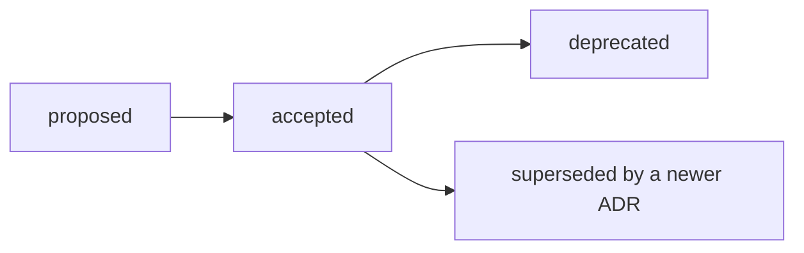

# Architecture Decision Records

This directory records the structuring decisions made for
`talk-control-revealjs-extensions`, using a lightweight
[MADR 4](https://adr.github.io/madr/) format.

An Architecture Decision Record (ADR) is a short, immutable document that
captures a structuring decision together with its context and consequences,
so that future contributors understand _why_ the codebase looks the way it
does, not only _what_ it does.

## Index

| ADR                                             | Title                         | Status   |
| ----------------------------------------------- | ----------------------------- | -------- |
| [0001](./0001-record-architecture-decisions.md) | Record architecture decisions | accepted |

## When to write an ADR

Write an ADR for any structuring decision, for example:

-   adding, removing, or replacing a structuring dependency (a framework, a
    build tool, a peer dependency);
-   changing a public output format (the bundle shape, the exposed API, the
    exported CSS/Sass surface);
-   changing a public API contract that consumers rely on;
-   introducing or changing a cross-cutting convention (testing strategy,
    plugin architecture, tooling shared across the repository).

A bug fix, a refactor that does not change an externally visible contract, or
a new addon that follows an existing pattern does not need an ADR.

When in doubt, prefer writing one: a short, skipped-if-irrelevant ADR costs
less than a structuring decision nobody can explain two years later.

## Lifecycle

-   **proposed**: drafted and under discussion, usually in the pull request
    that introduces it.
-   **accepted**: the decision is in effect. An accepted ADR is **immutable**:
    its content is never rewritten to reflect a change of mind. Only a typo or
    a factual clarification that does not change the decision may be edited.
-   **deprecated**: the decision no longer applies and nothing replaces it.
-   **superseded by ADR-NNNN**: a later ADR replaces this one. Update the
    status line to point to the new ADR; do not delete the superseded file.

To change a decision, write a **new** ADR and mark the old one as superseded.
The history of _why_ the codebase evolved stays readable.

## How to write an ADR

1. Copy [`0000-template.md`](./0000-template.md) to
   `NNNN-short-title-in-kebab-case.md`, where `NNNN` is the next free
   four-digit number (check the index above and any ADR pull request already
   open, since the number is only finalized when the pull request is
   rebased before merging).
2. Fill in at least _Context and Problem Statement_, _Considered Options_,
   _Decision Outcome_, and _Consequences_. _Decision Drivers_ and _Pros and
   Cons of the Options_ are optional — keep them only when they add
   information the rest of the ADR does not already carry.
3. Set `status: 'proposed'` in the front matter while the pull request is
   under review, and switch it to `accepted` once merged.
4. Add a row to the index table above, in the same pull request.

See [`AGENTS.md`](../../AGENTS.md) and
[`CONTRIBUTING.md`](../../CONTRIBUTING.md) for how this fits into the
project's conventions.
